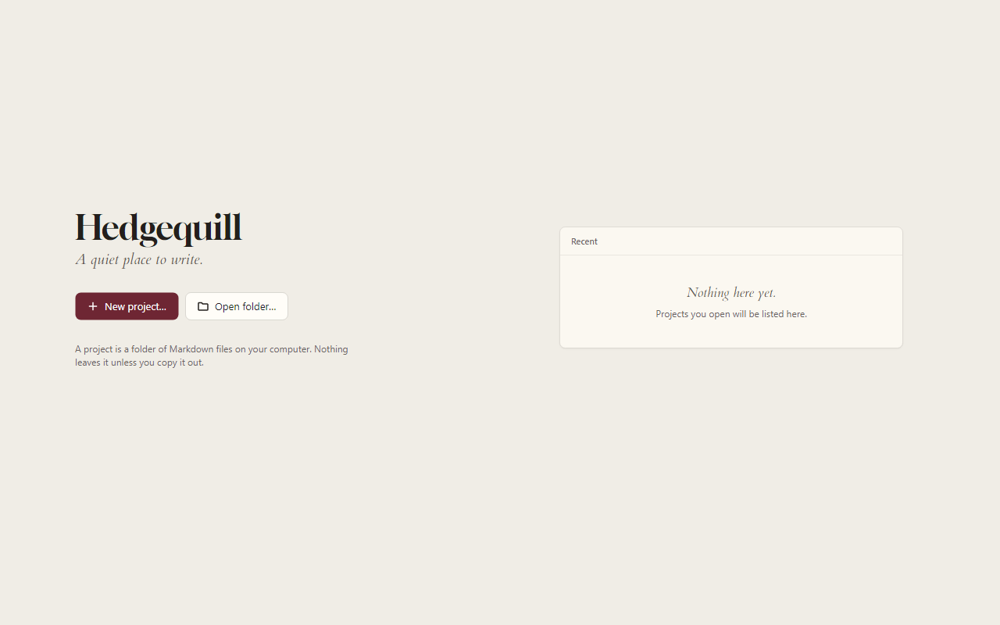

<h1 align="center">
  <picture>
    <source media="(prefers-color-scheme: dark)" srcset="docs/brand/lockup-dark.svg">
    
  </picture>
</h1>

**A quiet place to write.** Hedgequill is a free desktop app for writing fanfiction on your own computer and posting it to AO3.

Writing apps for long fiction tend to be paid, or busy with features a fic doesn't need. Simple Markdown editors have no idea what a chapter or a scene is. And getting a chapter into AO3 with its italics and scene breaks intact means pasting and checking by hand. Hedgequill is one calm window for the whole job, and your words stay in plain files on your computer.

<picture>
  <source media="(prefers-color-scheme: dark)" srcset="docs/screenshots/welcome-dark.png">
  
</picture>

> **Status: early.** The Welcome screen is all there is so far, and there's nothing to download yet. [ROADMAP.md](ROADMAP.md) says what gets built, in what order.

## Before and after

| You're… | In one long document | In Hedgequill |
|---|---|---|
| moving a scene | cut and paste, then find where it was | drag it in the list |
| writing in italics | toolbar buttons, or markup you have to remember | Ctrl+I; the markers stay faded, so italics look like italics |
| posting a chapter | copy it out, then check what survived the paste | Copy for AO3, then paste into AO3's HTML editor; the preview shows what AO3 will keep |
| hitting a save error | hope the last save was recent | your text stays on screen, with Retry and Save a copy… |

## What it does

- **One window:** a list of acts › chapters › scenes, plus Notes and Research pages; the page you're writing; and an AO3 preview you can hide.
- **No markup to learn.** The files are Markdown, but Ctrl+B, Ctrl+I and the scene-break button add the markers for you.
- **Copy for AO3:** puts a chapter on the clipboard as HTML for AO3's editor, limited to what AO3 keeps: paragraphs, emphasis, headings, quotes and scene breaks.
- **Plain files:** a project is a folder of Markdown files plus one small file for their order. Any text editor can open them, with or without Hedgequill.

## The promise

- **Never lose words.** Hedgequill saves as you type. If a save fails, your text stays on screen until it's somewhere safe.
- **Private.** No account and no telemetry. Your writing never leaves your computer unless you copy it out. The only network request is the update check, which asks GitHub Releases for a newer version and sends nothing about you or your writing.
- **Always up to date.** Updates download quietly and install when you close the app. It never restarts on its own.

Windows and macOS. Open source, so you can check all of this.

## Alternatives

Checked against each product's own website and docs on 2026-11-12. Hedgequill's row is the plan, not a release.

| | Price | Runs on | Your files | Fiction structure | While you write | AO3 |
|---|---|---|---|---|---|---|
| **Hedgequill** (planned) | free, open source | Windows, macOS; offline, no account | Markdown in a folder you pick | acts, chapters, scenes, notes, research | markup faded | Copy for AO3 |
| [Scrivener](https://www.literatureandlatte.com/scrivener/overview) 3.5.2 Mac, 3.1.6 Win | $59.99 once, per platform | Windows, macOS, iOS | a `.scriv` project package | binder, corkboard, outliner, research | word processor | no AO3 option; compiles to ePub, PDF, Word |
| [novelWriter](https://novelwriter.io/) 2026.2.2 | free, open source | Windows, Linux; macOS only through Python | plain-text files named by ID, plus an XML index | chapters and scenes from headings, tagged notes | you type the markup | no AO3 option; builds HTML, DOCX, PDF, EPUB |
| [Obsidian](https://obsidian.md/) 1.15.1 with [Longform](https://github.com/kevboh/longform) 2.1.0 | free; Sync and Publish are paid extras | desktop and mobile; offline, no sign-up | Markdown in a folder you pick | Longform: a reorderable, nestable list of scenes | Live Preview hides most markup | no AO3 option; Longform compiles to a Markdown note |
| [Ellipsus](https://ellipsus.com/) | free plan; Plus $6 a month or $99 once | browser and mobile; desktop apps "coming soon"; account required | online documents; download one at a time as .docx, PDF or .md | folders for chapters and research, drafts | rich text | **Export to AO3**: copies HTML and opens AO3 |
| [Typora](https://typora.io/) 1.14 | $14.99 once | Windows, macOS, Linux | Markdown files | none | live preview hides markup | no AO3 option; copy or export as HTML |
| [iA Writer](https://ia.net/writer) 2.1 Win, 8.0 Mac | $29.99 Win, $49.99 Mac, once | Windows, macOS, iPhone, iPad | plain-text Markdown | folders; Content Blocks on Mac | markup stays; Preview shows it styled | no AO3 option; copy or export as HTML |

**Pick Scrivener** for a corkboard and outliner, research files of any kind inside the project, or compiling to ePub, print PDF or Word. **Pick novelWriter** for free, open-source writing with notes on characters and plot tagged to scenes, and manuscript builds. **Pick Obsidian with Longform** if your notes already live in Obsidian, or you want links, plugins and mobile apps. **Pick Ellipsus** to write with others in real time, write on your phone, or post and edit AO3 chapters in one click, and you don't mind an account and a connection. **Pick Typora or iA Writer** for a polished Markdown editor for everything, not just fiction.

## Contributing

Issues are welcome. Open work and decisions are in [ROADMAP.md](ROADMAP.md).

## License

[Apache-2.0](LICENSE). The wordmark uses [Gloock](https://github.com/google/fonts/tree/main/ofl/gloock), under the SIL Open Font License 1.1.
